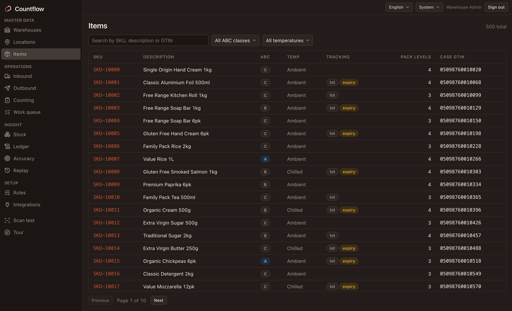
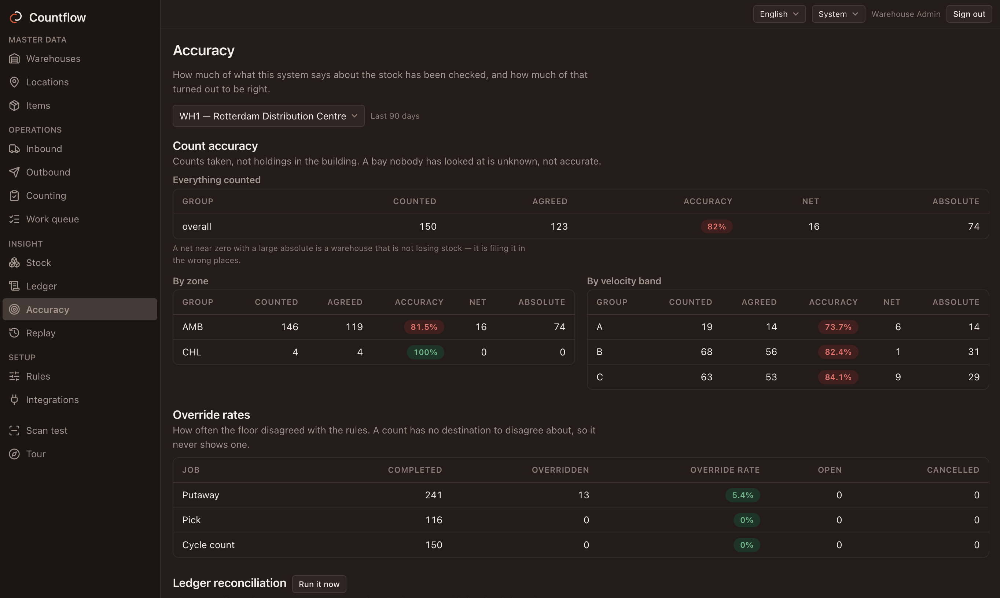

<p align="center">
  <picture>
    <source media="(prefers-color-scheme: dark)"
            srcset="docs/assets/logo-horizontal-on-dark.svg">
    
  </picture>
</p>

<p align="center">
  <strong>A warehouse management system that can prove what happened, explain why
  it happened, and let you test a change before you make it.</strong>
</p>

<p align="center">
  <a href="https://github.com/REDLANTERNDEV/Countflow/actions/workflows/ci.yml"></a>
  <a href="LICENSE"></a>
  
  
  
</p>

<p align="center">
  <a href="CHANGELOG.md">What's in it</a> ·
  <a href="docs/history.md">How it was built</a> ·
  <a href="ROADMAP.md">What's next</a> ·
  <a href="docs/api/">Integrating</a> ·
  <a href="CONTRIBUTING.md">Contributing</a>
</p>

Countflow is an open-source warehouse management system for a single-company
distribution centre. It directs receiving, putaway, picking, packing, shipping,
and cycle counting. Every stock movement is recorded in an append-only ledger,
and every operational decision can be inspected and replayed.

## Product screenshots

Master data and warehouse accuracy in the Countflow console.

<table>
  <tr>
    <td width="50%" valign="top">
      <a href="docs/assets/screenshots/item-catalogue.png"></a>
      <br><strong>01 / Master data: Item catalogue</strong><br>
      Five hundred SKUs, with handling and traceability attributes visible at a glance.
    </td>
    <td width="50%" valign="top">
      <a href="docs/assets/screenshots/stock-accuracy.png"></a>
      <br><strong>02 / Warehouse insight: Stock accuracy</strong><br>
      Count agreement, zone and velocity breakdowns, and override rates in one operational view.
    </td>
  </tr>
</table>

---

## Core capabilities

### 1. Inventory ledger

Stock changes are append-only movements between locations. Nothing is created
or destroyed, only moved:

```
Receive    SUPPLIER      → DOCK-01
Putaway    DOCK-01       → A-07-03-02
Pick       PICK-B-12     → CART-004
Ship       PACK-STN-02   → CUSTOMER
Count loss A-07-03-02    → ADJUSTMENT
```

Balances can be rebuilt and reconciled from the ledger. The system can report
what each location held at any past timestamp. See [decision 1](docs/decisions.md#1-inventory-truth-is-an-append-only-ledger).

### 2. Explainable warehouse decisions

Putaway and lot allocation decisions record the candidates, rules, score, and
rejection reasons. Supervisors and operators can inspect the same trace.

```
Putaway for SKU-10001 ×24   rule set "Standard putaway" v1
  chose  WH1-STOR-AMB-A01-01-02-A   score 0.598
    + location is empty
    + C-class item in a reserve location
    + zone AMB, 10% along the route
  rejected: occupied dock, wrong-temperature zone
```

Lot allocation applies the same trace to expiry dates, customer shelf-life
requirements, location, and travel distance. It can split an order across eligible
batches. API responses contain language-neutral codes and arguments; the UI gets
translated wording from `packages/i18n`.

### 3. Rule replay

Replay tests a candidate rule set against decisions from the ledger before the
change is promoted. It reports exact reproductions and changed outcomes.

```
RPL-2026-0011  Putaway  Standard putaway v1  against Standard putaway v1
  121 replayed · 121 reproduced exactly · 0 changed · 893 ms

  rule                             weight    asked   realised   spread
  putaway.consolidate_same_item      0.35    35.0%      55.1%    0.586
  putaway.velocity_slotting          0.25    25.0%      22.1%    0.410
  putaway.travel_distance            0.25    25.0%      15.5%    0.192
  putaway.cube_utilisation           0.15    15.0%       7.4%    0.142
```

Replay measures fidelity by reporting how many decisions were reproduced
exactly. It also compares configured rule weights with their realised effect.

### 4. Offline handheld

Every handheld write enters a durable IndexedDB queue with its original
idempotency key. Commands sync when the connection returns. If warehouse state
has changed, the operator gets a conflict and instructions. See [decision 8](docs/decisions.md#8-the-handheld-writes-to-a-durable-queue).

---

## Running it

The only prerequisite is Docker.

```bash
docker compose up
```

Compose starts PostgreSQL, applies migrations, seeds demo data, and serves the
console, handheld, and API:

| | |
|---|---|
| Console | http://localhost:8000 |
| Handheld | http://localhost:8000/handheld/ |
| API | http://localhost:8080 |
| API reference (Scalar) | http://localhost:8080/scalar/v1 |
| Logs (Seq) | http://localhost:5341 |

The seed includes **2,245 locations** across 30 aisles and **500 SKUs** with
ABC classes, lot and expiry tracking, and packaging hierarchies.

Use **Scan test** to inspect GS1-128 decoding. Browse **Items**, **Stock**,
**Ledger**, and **Accuracy** for master data and warehouse metrics. The ledger
starts empty. Run the simulator to generate receipts, picks, counts, and replay
data:

```bash
export COUNTFLOW_SUPERVISOR_SECRET=Countflow#2026 \
       COUNTFLOW_OPERATOR_SECRET=Countflow#2026 \
       COUNTFLOW_ADMIN_SECRET=Countflow#2026
cd backend && dotnet run --project src/Countflow.Simulator -- --days 4
```

Demo sign-ins are available when demo seeding is enabled:

| User | Operator code | Role |
|---|---|---|
| `admin` | `ADM001` | Admin |
| `supervisor` | `SUP001` | Supervisor |
| `operator` | `OP001` | Operator |

Password for all three: `Countflow#2026`.

### Working on it

```bash
cd backend  && dotnet build && dotnet test     # needs Docker: real PostgreSQL
cd frontend && pnpm install && pnpm dev        # HMR against the API on :8080
```

Full setup, every command, and the review bar: [CONTRIBUTING.md](CONTRIBUTING.md).

After changing an endpoint, run `pnpm export:openapi && pnpm generate:api` to
refresh the OpenAPI document and client types.

---

## Integrating with it

The console, handheld, and simulator use the same versioned API. Integrations
use service accounts with API keys and the same roles as human users. See
[decision 7](docs/decisions.md#7-the-public-surface-is-the-surface).

```bash
curl -s -H "X-Api-Key: cfk_…" https://your-host/api/v1/auth/me
```

Read inventory changes in sequence to keep an external system up to date:

```bash
curl -s -H "X-Api-Key: cfk_…" \
  "https://your-host/api/v1/inventory/changes?afterSequence=4468&limit=200"
```

See **[docs/api/](docs/api/)** for authentication, compatibility, idempotency,
pagination, error codes, and worked warehouse flows.

## Public demo

For a lightweight public demo, use **`compose.demo-static.yaml`** on Dokploy or
Coolify, or publish the static build on your preferred host.
It serves the existing UI with private browser-local sample data; no API or
database runs on the server. The [static demo hosting guide](docs/demo-hosting.md)
covers Docker, Nginx, Caddy, Dokploy, Coolify, Netlify, and Vercel in one place.

To run the full backend demo locally:

```bash
./scripts/demo.sh
```

Generates secrets, starts the stack, and populates the warehouse by driving the
public API with the simulator. See [decision 6](docs/decisions.md#6-the-simulator-is-a-client-not-a-module).

The demo login lists available accounts. The **Tour** link explains each screen.
See [hosting instructions](docs/api/hosting.md) to use a custom domain.

---

## Architecture

```
backend/                     .NET 10 · modular monolith · vertical slices
  src/Countflow.Api          host, endpoints, auth, OpenAPI
  src/Countflow.Migrator     runs migrations + seeders, then exits
  src/Countflow.Bootstrap    the single module catalog both hosts compose from
  src/Countflow.SharedKernel Result, module plumbing, GS1 parser, rules engine
  src/Modules/*              one PostgreSQL schema and DbContext each
frontend/                    pnpm workspace · Vite + React + TypeScript
  apps/console               admin and supervisor SPA
  apps/handheld              offline-first PWA for scanners; every write goes
                             through a durable IndexedDB queue ([decision 8](docs/decisions.md#8-the-handheld-writes-to-a-durable-queue))
  packages/api-client        generated from OpenAPI; never hand-edited
docker/                      Dockerfiles + Caddy edge config
docs/                        documentation and the API reference
```

See [architecture](docs/architecture.md) for the module map and request flow.
The design rationale is in [decisions](docs/decisions.md).

- **Migrations run in a one-shot container, never on API startup.** Two API
  replicas booting together would otherwise race on the same migration, and EF's
  history table is not a distributed lock.
- **The API image runs as a non-root user** and has no shell or package manager.

---

## Standards

Countflow supports **GTIN** (GS1 AI `01`), **SSCC** (`00`), **GS1-128**, and
**EDI 856/940/945**. GS1-128 parsing covers item, lot, expiry, and quantity.

## Scope

Countflow targets one company's distribution centre. Labour management, 3PL
billing, robotics, yard scheduling, carrier shopping, inventory costing, and
multi-tenant hosting are out of scope. See the [roadmap](ROADMAP.md) for planned
work.

## Contributing

Issues and pull requests are welcome. See [CONTRIBUTING.md](CONTRIBUTING.md) for
setup and review requirements, [invariants](docs/invariants.md) for system
constraints, and [gotchas](docs/gotchas.md) for known pitfalls.

Security reports: see [SECURITY.md](SECURITY.md). Please do not open a public
issue.

## Licence

[GPL-3.0](LICENSE)
